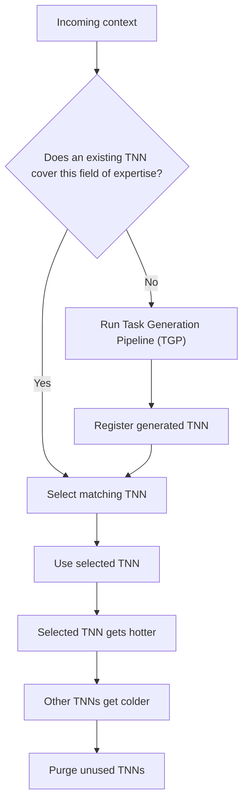
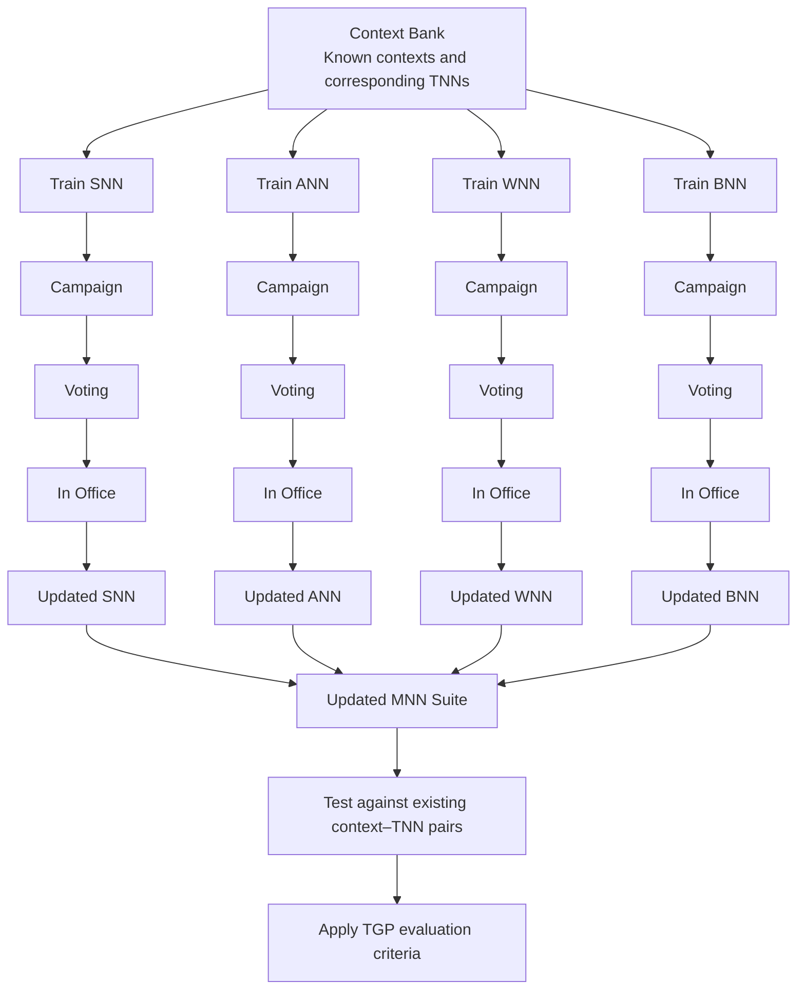

# Just-In-Time Machine Learning (JITML)

## Abstract

Just-In-Time Machine Learning (JITML) replaces the assumptions of Ahead-Of-Time Machine Learning (AOTML) with runtime adaptability. Through a pipeline of meta-networks (MNNs), JITML dynamically generates task-networks (TNNs) to handle unfamiliar contexts as they arise.

## The Limitations of AOTML

Most current machine-learning paradigms rely primarily on AOTML: network parameters are computed against finite datasets before deployment. When these models encounter unfamiliar contexts, they may fail to adapt without complete retraining. This makes them brittle in highly dynamic environments.

AOTML's limited structural adaptability also creates a trade-off: a model must be either broadly general-purpose or narrowly specialized for a single domain. JITML takes a different approach. It starts from a baseline configuration that can adapt to diverse contexts at runtime, without requiring retraining for every new context.

## Core Components of JITML

JITML separates the system into two types of feed-forward neural networks (FFNNs):

- **Task-networks (TNNs):** Compact, specialized networks designed to process groups of similar contexts. Each TNN develops a field of expertise as it is selected for relevant tasks.
- **Meta-networks (MNNs):** Networks responsible for generating new TNNs dynamically. Each MNN governs a particular aspect of the TNN being constructed.

The Task Generation Pipeline uses the following MNN components:

- **Shape-network (SNN):** Determines the structure of a new FFNN.
- **Activation-network (ANN):** Selects activation functions for the FFNN's layers.
- **Weight-network (WNN):** Generates the FFNN's weight values.
- **Binary-network (BNN):** Included in the generation pipeline and the MNN training suite. Its distinct runtime responsibility is not further specified in this architecture description.

## Task Generation Pipeline (TGP)

When JITML receives an unfamiliar context, that context is passed through the MNN pipeline. Each network governs one aspect of the new TNN.

### 1. Shape-network (SNN)

The SNN takes the current context as input. Using a sigmoid activation function, it produces a series of Boolean values describing the shape of the feed-forward neural network (FFNN). Slots that do not contain neurons are removed.

### 2. Activation-network (ANN)

The ANN receives an object describing the generated network's shape. Based on that structure, it selects the activation function for each layer.

### 3. Weight-network (WNN)

The WNN receives the network object populated with activation functions. It generates the exact values to be used as weights. Very low-value weights are removed.

The resulting network is already pruned: empty neuron slots and very low-value weights have been removed, producing a more compact TNN.

### 4. Binary-network (BNN)

The BNN is shown as the final MNN stage in the TGP sequence. Its specific runtime operation is not defined in the current architecture description.

### Task Generation Flow

```mermaid
flowchart LR
    Context["Context"] --> SNN["Shape-network (SNN)"]
    SNN --> ANN["Activation-network (ANN)"]
    ANN --> WNN["Weight-network (WNN)"]
    WNN --> BNN["Binary-network (BNN)"]
    BNN --> Campaign["Campaign"]
    Campaign --> Voting["Voting"]
    Voting --> InOffice["In Office"]
    InOffice --> TNN["Task-network (TNN)"]
```

### Deterministic Candidate Selection

After the MNNs generate the initial TNN, the TGP uses a deterministic selection stage to improve on the probabilistic outputs of the MNNs.

1. **Campaign:** The generated TNN's parameters are mutated to produce a specified number of candidates.
2. **Voting:** Each candidate is evaluated against a set of criteria. These criteria prioritize output cleanliness, favoring predominant output features or values with lower entropy.
3. **In Office:** The winning output is used by JITML. The TNN that generated it is added to the task queue, and the current context becomes part of that TNN's field of expertise.

## TNN Lifecycle

JITML continuously routes incoming contexts to task-networks. For each new context, the system either selects an existing TNN whose field of expertise matches the context or invokes the Task Generation Pipeline to create a new one.

TNNs also have a usage-based lifecycle:

- A TNN becomes **hotter** each time it is selected.
- TNNs that are not selected become **colder**.
- Sufficiently cold, unused TNNs are purged to free up resources.

### TNN Selection and Lifecycle Flow

## Meta Training Pipeline (MTP)

Because JITML is designed to handle unknown contexts, its MNNs are trained through a bootstrapping process. This process uses the known contexts stored in the **Context Bank**, together with their corresponding TNNs.

Each MNN is trained separately:

1. **SNN:** Trained on the Context Bank to improve its ability to develop new FFNN architectures.
2. **ANN:** Trained to associate the different structural outputs of the SNN with appropriate activation-function selections.
3. **WNN and BNN:** Trained according to the same principle, resulting in more refined weight and bias selections.

For each MNN, the training process is followed by the same candidate-generation and selection stages used in the TGP: Campaign, Voting, and In Office. The resulting networks form the updated MNN suite.

Once the new MNN suite is ready, it is tested against the existing context–TNN pairs to ensure that performance has not degraded. As an additional safeguard, it is evaluated using the same criteria outlined in the TGP.

### Meta Training Flow

