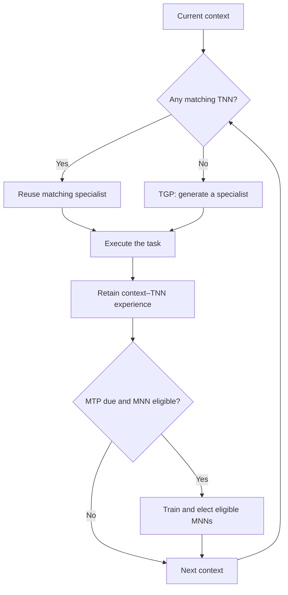
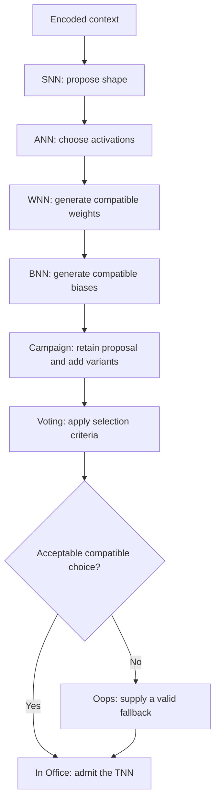
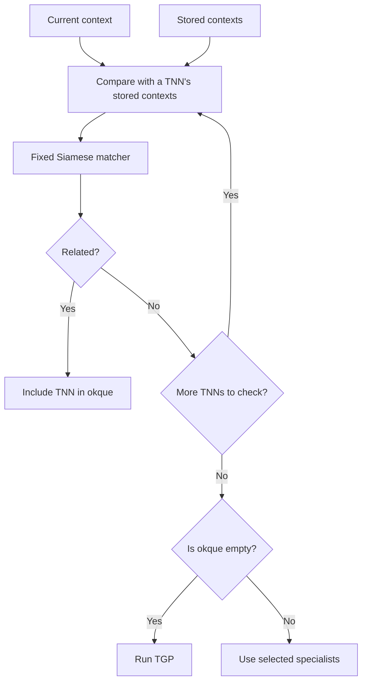
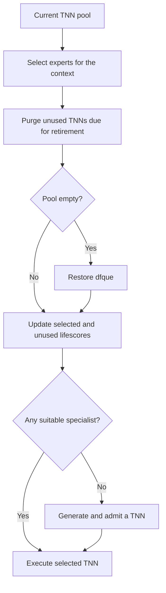
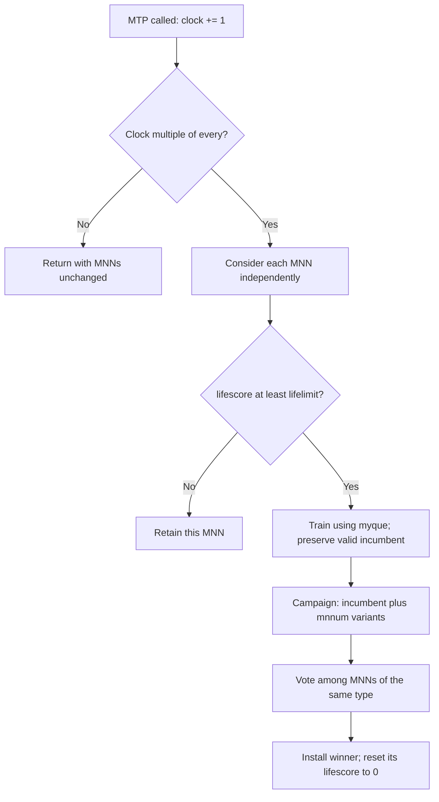
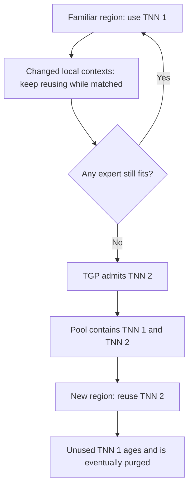

# Just-in-Time Machine Learning (JITML)

**Reuse specialists. Generate when needed. Refine the generators.**

JITML is an adaptive machine-learning architecture built around a changing pool of task specialists. When a context matches an existing specialist, the system reuses it. When no specialist fits, a suite of meta-networks generates a new neural network for that context. Periodic meta-training uses the accumulated context–network pairs to refine the generators themselves.

The architecture brings together expert routing, network generation, candidate elections, and usage-based retirement. Its organizing principle is economical adaptation: do the work the current context requires, and retain the specialists that continue to be useful.

## Architecture at a glance

| Term | Meaning | Responsibility |
| --- | --- | --- |
| **TNN** | Task neural network | Performs the task; retains current and past contexts associated with its expertise. |
| **MNN** | Meta neural network | One of the generators that defines part of a TNN. |
| **SNN** | Shape neural network | Selects the network structure. |
| **ANN** | Activation neural network | Selects activation functions for the layers. |
| **WNN** | Weight neural network | Generates weights compatible with the selected structure and activations. |
| **BNN** | Bias neural network | Generates the corresponding biases. |
| **TGP** | Task Generation Pipeline | Proposes, varies, evaluates, and admits a new TNN. |
| **MTP** | Meta Training Pipeline | Trains and elects the MNNs using retained context–TNN experience. |
| **Siamese** | Context matcher | Compares the current context with a specialist's stored contexts. |

Here, **ANN** specifically names the activation generator. **SNN** specifically names the shape generator.

The diagram summarizes the feedback loop. The runtime also manages specialist lifetimes, as described below.

## 1. Task Generation Pipeline

The TGP begins with the current context represented numerically. An embedding or encoding step supplies this representation for inputs such as text or images; the toy environment supplies a numerical grid directly.

The canonical generator chain is **context → SNN → ANN → WNN → BNN**. Later decisions depend on the earlier ones: weights must fit the chosen structure and activations, and biases must fit the resulting layers.

### Shape and activation outputs

The SNN describes structure on a fixed output canvas. Hot positions represent active neuron slots; cold positions represent absent slots. Decoding the mask gives the layer sizes.

The ANN makes a categorical choice for each represented layer. Its output uses hot positions to identify the chosen activation; ties need a defined resolution rule. These discrete descriptions are packaged together for the WNN, followed by the BNN.

| Generator | Output interpretation |
| --- | --- |
| SNN | An occupancy mask decoded into `layersize`. |
| ANN | A choice among allowed activations for each layer, decoded into `activfunc`. |
| WNN | Weight arrays matching the selected network, stored as `weigvalue`. |
| BNN | Bias arrays matching the selected network, stored as `biasvalue`. |

`Activations` maps the allowed names to PyTorch modules. `Argof` organizes their initialization arguments by family: ReLU, smooth, sigmoid, threshold/shrinkage, gating, classification, and identity.

### The election object

`Elec` carries the shared generation and election state. It separates the initial proposal (`init`) from campaign candidates (`cand`) for each part of the network.

| Part | Initial proposal | Candidate collection |
| --- | --- | --- |
| Shape | `elec.lays.init` | `elec.lays.cand` |
| Activations | `elec.acti.init` | `elec.acti.cand` |
| Weights | `elec.weig.init` | `elec.weig.cand` |
| Biases | `elec.bias.init` | `elec.bias.cand` |

Each collection includes its original proposal plus the variants produced by `of_TGP(..., ctx.tnnum)`. With `tnnum = 7`, that is eight entries **per parameter family**, rather than eight independently assembled complete TNNs.

### Campaign → Voting → In Office

**Campaign** explores nearby alternatives. Variations can perturb weights or biases, exchange allowed activation functions, or alter the structure. A structural change requires compatible downstream parameters: the WNN must regenerate or patch the weights, and the biases must also fit. Activation changes must respect the same compatibility requirement.

**Voting** applies the chosen criteria. These may combine deterministic checks, known input–output examples, task feedback, probabilistic scoring, and learned evaluators. Output entropy can contribute to selection, alongside evidence that the output actually serves the task. Inference already computed for the election can be reused when executing the selected TNN.

The four field selections share `Elec`. Acceptance therefore concerns the compatibility of the assembled network, even though `Vote` exposes a separate method for each field.

**Oops** handles rejection by the normal criteria. Its rules must provide a valid fallback when no proposal qualifies. This guarantees a usable structural choice under the fallback policy; task performance is still determined by the task criteria.

**In Office** is the admission stage: the selected, compatible definition becomes a TNN available to the runtime.

The canonical path includes all four generators. A deployment may fix a choice, such as structure or activations, and omit the corresponding generation step. BNN is optional when the chosen design does not need generated biases.

## 2. Routing by field of expertise

Each TNN retains contexts associated with its use. Routing compares the current context with those records to decide whether that specialist is relevant.

The canonical matcher is a **fixed Siamese neural network**: it takes current and past contexts and returns a Boolean similarity decision. It remains unchanged during TGP and MTP. Another matching method can serve the same interface.

`myque` is the current specialist pool, `okque` contains specialists selected for the current context, and `dfque` holds the baseline specialists used to restore an empty pool.

## 3. Specialist lifecycle

`lifescore` acts as an age counter. A **lower** score means a specialist is further from retirement.

| TNN event | Score update | Effect |
| --- | --- | --- |
| Selected for the current context | `lifescore -= 1` | Frequent use keeps the specialist younger. |
| Unused for the current context | `lifescore += 1` | Continued inactivity moves it toward retirement. |
| Retirement condition reached | Purge the unused TNN | Release its resources. |
| Current pool becomes empty | Restore the default TNN set | Re-establish the baseline. |

This is a usage-based retention policy. It favors a core of recurring specialists without discarding them after a brief lapse in use. A hard pool-size limit is an optional extension; the supplied architecture does not impose one. Such a limit can retire a less useful specialist before admitting another when capacity is reached.

## 4. Meta Training Pipeline

The MTP adapts the generators using retained contexts and the TNN definitions associated with them. Each MNN learns its own target: structure, activations, weights, or biases.

MTP scheduling uses two gates:

1. Increment `ctx.clock` when `MTP(ctx)` is called. Continue only when the clock is a multiple of `ctx.every`.
2. For each MNN independently, check `lifescore >= lifelimit`.

With `every = 3`, each third MTP call opens the scheduling gate. An individual generator is trained and elected only if it also meets its own lifespan threshold.

The elections are separate: SNN competes with SNN candidates, ANN with ANN candidates, and likewise for WNN and BNN. With `mnnum = 7`, each eligible election includes the incumbent plus seven generated alternatives.

Unlike TGP, MTP starts with an accepted network of the required type. Training is intended to preserve that valid incumbent as an eligible choice, so a separate `Oops` stage is unnecessary: voting can retain the incumbent when alternatives do not qualify.

### Two different aging rules

TNNs age according to use in the task loop. MNNs age according to **generation work**: each TGP call increments the four canonical MNN lifescores by one. Reusing a TNN does not, by itself, age those MNNs. After an eligible MTP election, the installed MNN's score resets to zero.

This keeps meta-training tied to how much the generators have actually been used, while the clock limits how often the runtime considers an update.

## 5. Toy environment: red and blue tiles

The toy problem places an agent on a numerical grid. Tiles are blue (`0`) or red (`1`), and the agent is overlaid by adding `2` to the occupied tile. The goal condition is reaching the last row.

| Setting | Current default |
| --- | --- |
| Board | 42 rows × 37 columns |
| Start | Row 37, column 17, using zero-based indices |
| Local radius | 1; up to a 3 × 3 window, clipped at the edges |
| Commands | `Up`, `Dn`, `Lf`, `Rg`, clamped to the board |
| Random generator | `Random(42)` |

The board generation decreases the blue sampling weight down the rows. In the supplied `numgrid`, the red weight rises from zero to one and then stays at one. The tile colors supply numerical context; `Env.move()` applies the four commands directly.

The supplied toy illustration shows the intended specialist lifecycle as the encountered contexts change:

This sequence illustrates routing and retention; it does not assign an extra movement rule to either tile color. The [Wolfram notebook](arcdef.nb) includes compact board illustrations alongside the architecture.

## Runtime and source map

`jitml(ctx)` delegates the loop to `Step` in this order:

| Order | Hook | Responsibility |
| --- | --- | --- |
| 1 | `doneplay` | Check whether the task has finished. |
| 2 | `uirender` | Render the environment. |
| 3 | `keepbusy` | Select specialists that match the current context. |
| 4 | `killdead` | Purge unused specialists due for retirement. |
| 5 | `givelife` | Reward selected specialists and age unused ones. |
| 6 | `needstgp` | Generate a specialist when `okque` is empty. |
| 7 | `makemove` | Run the selected behavior in the environment. |
| 8 | `needsmtp` | Invoke the scheduled meta-training check. |

| Module | Architectural role |
| --- | --- |
| `netdef` | Common network state, TNN and MNN interfaces, Siamese matcher, nested-list aliases. |
| `jitdef` | `Ctx`, queues, configuration, and the `jitml` loop. |
| `tgpdef` | `Elec`, TGP field elections, `Oops`, and TNN assembly. |
| `mtpdef` | Clock and lifespan gates, per-type MNN elections, and score resets. |
| `canddef` | Candidate-generation interfaces for campaigns. |
| `activdef` | Activation catalogue and initialization arguments. |
| `envdef` | Toy board, local observation, movement, and completion condition. |
| `defval` | Preset network definitions, including the fixed Siamese network. |
| `stepdef` | Runtime hooks called by `jitml`. |

`Grid[T]`, `Cube[T]`, and `Tess[T]` name two-, three-, and four-level nested lists. They describe storage order; a TNN's layer matrices can have different dimensions.

## Author

**Ghetea Patrick** · [@ghetea-patrick](https://github.com/ghetea-patrick)

Email (fast): [gheteapatrick@gmail.com](mailto:gheteapatrick@gmail.com)  
Email (slow): [patrick_ghetea@outlook.com](mailto:patrick_ghetea@outlook.com)

Copyright (c) 2026 Ghetea Patrick. All rights reserved.
